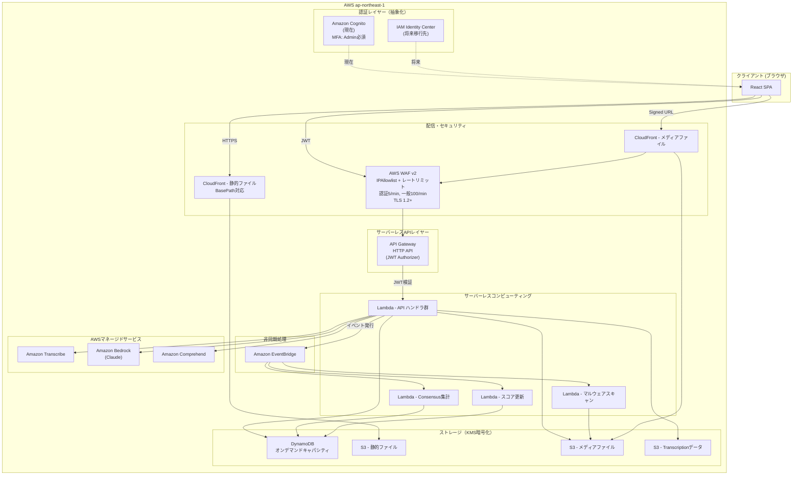
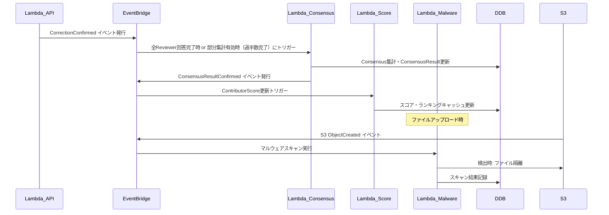
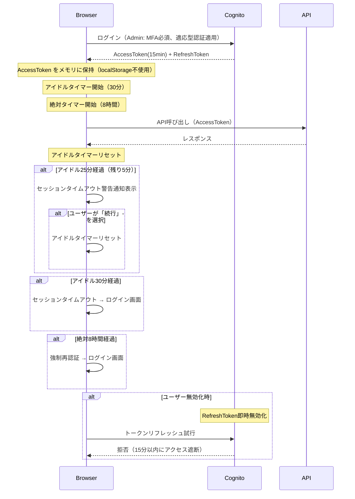
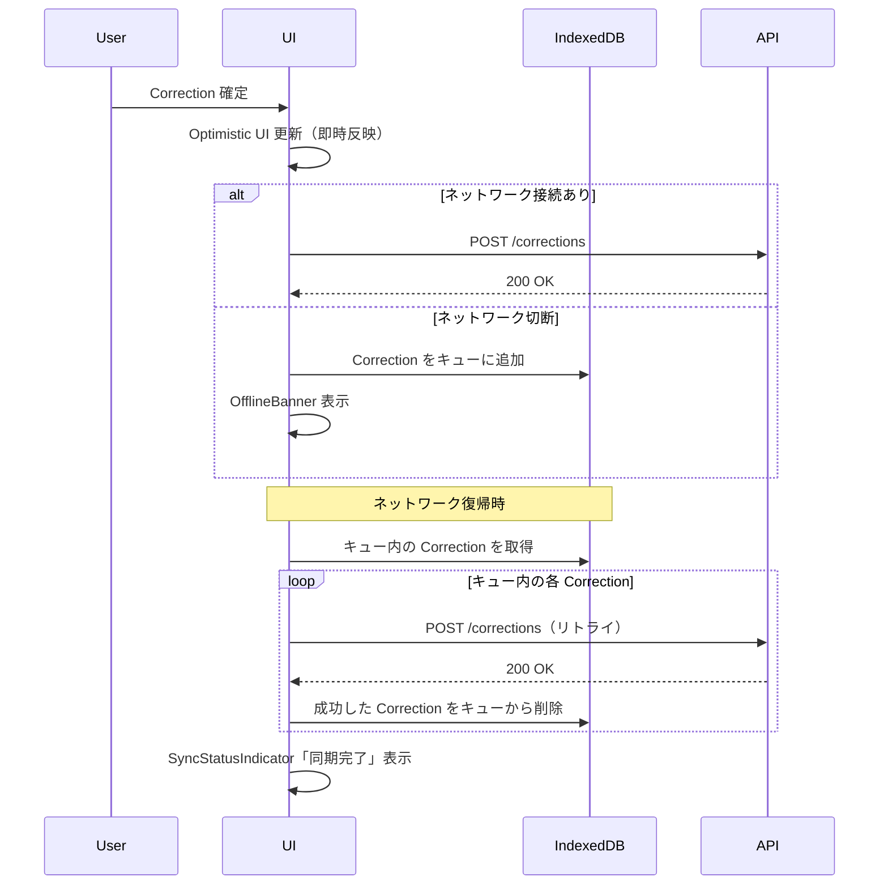
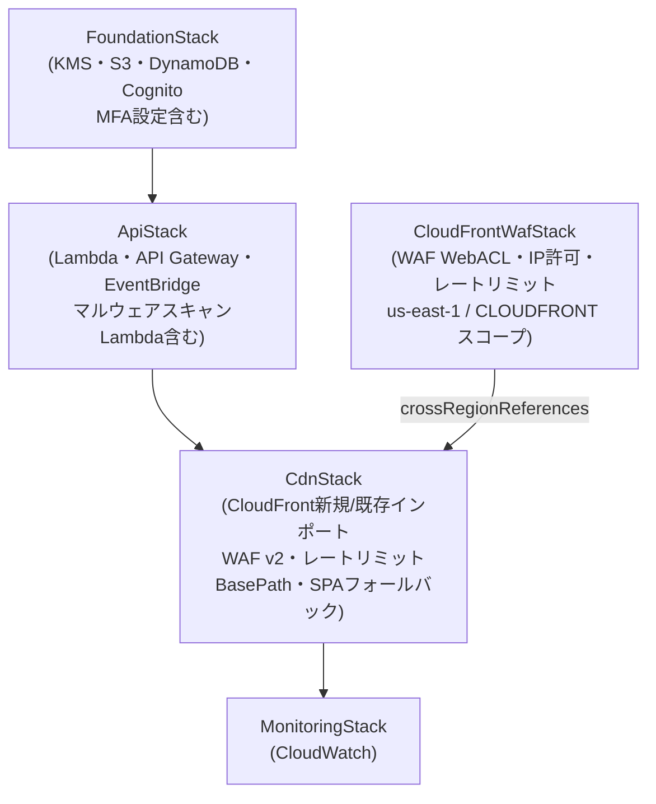
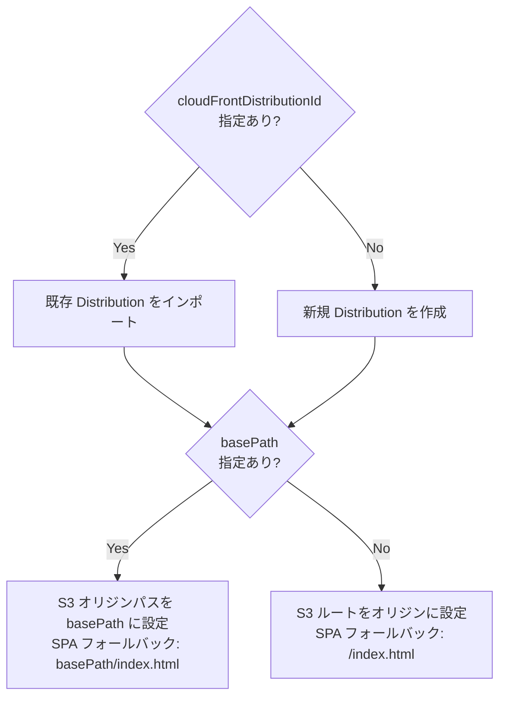
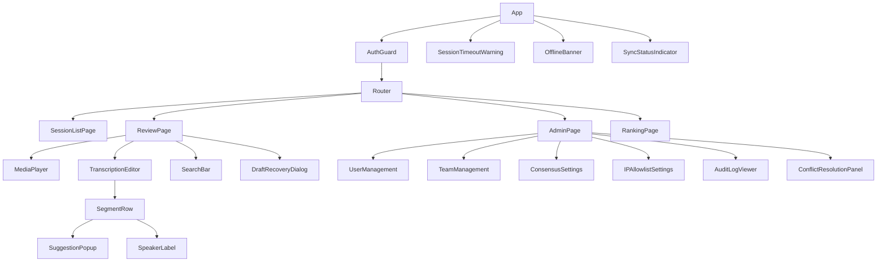
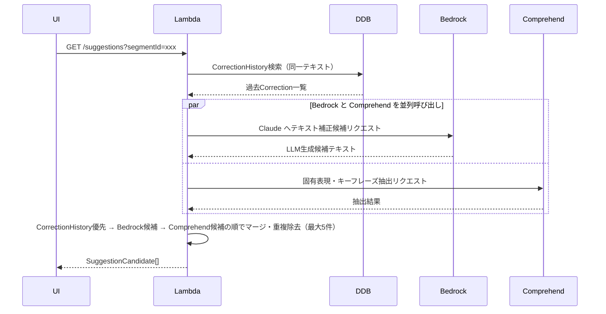
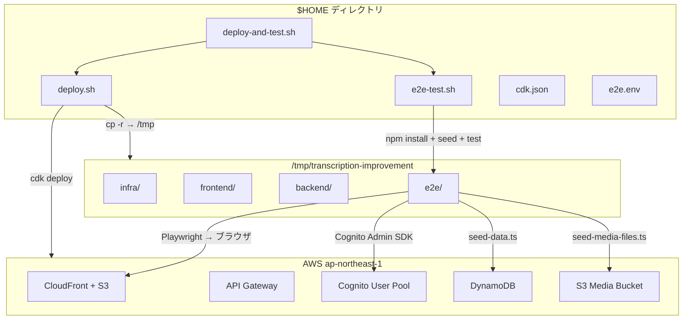
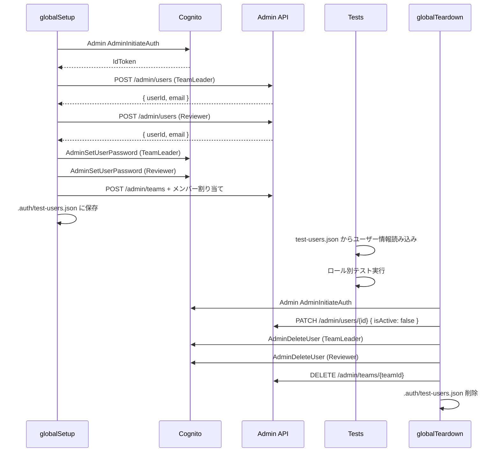

# Design Document: Transcription Review App

## Overview

本ドキュメントは、Amazon Transcribeが生成した文字起こし結果を人間の校閲者が確認・修正するためのWebアプリケーション（Transcription Review App）の技術設計を定義します。

### 目的

- Amazon Transcribeの文字起こし結果を効率よく校閲・修正できるUIを提供する
- 複数Reviewerによる多数決（Consensus）で信頼性の高い文字起こし結果を確定する
- チームベースのアクセス制御と監査ログによりセキュリティ・コンプライアンスを確保する
- すべてのリソースをAWS ap-northeast-1リージョンに限定する
- 既存 Cognito User Pool を指定した繰り返しデプロイを可能にし、データ保持を実現する
- メディアファイルのアップロードから Transcription 作成までのワークフローを自動化する
- カスタム言語モデルの作成・利用により文字起こし精度を向上させる
- 修正後 Transcription のダウンロード（JSON/SRT）を提供する
- 不要データの安全な削除機能を提供する

### 技術スタック

> **Single source of truth**: バージョン・コマンド・コーディング規約などの「常時適用ルール」は steering（`.kiro/steering/tech.md` / `structure.md` / `product.md`）を正とします。本テーブルは設計上の技術選定とその理由（意思決定記録）に焦点を当てます。重複する運用ルールは steering 側を参照してください。

| レイヤー | 採用技術 | 選定理由 |
|---|---|---|
| フロントエンド | React 19 (TypeScript), Vite 8, TailwindCSS 4 | SPA、型安全、軽量ビルド |
| バックエンドAPI | AWS Lambda + API Gateway HTTP API | サーバーレス、REST APIより最大70%低コスト |
| 認証（現在） | Amazon Cognito User Pools | サーバーレス認証、Managed MFA |
| 認証（将来） | AWS IAM Identity Center | Cognito → IAM Identity Center への移行を考慮し、認証レイヤーを抽象化して実装する |
| データベース | Amazon DynamoDB (オンデマンドキャパシティ) | サーバーレス、10人〜1500人のスケールに自動対応 |
| メディアストレージ | Amazon S3 + Amazon CloudFront | サーバーレス、署名付きURLでセキュアなストリーミング |
| 文字起こし | Amazon Transcribe | マネージドサービス |
| 修正候補LLM | Amazon Bedrock (Claude) + Amazon Comprehend | Bedrock: 文脈を考慮した高精度な候補生成、Comprehend: 固有表現・キーフレーズ抽出による候補補完、両者を組み合わせて候補品質を向上 |
| 非同期処理 | Amazon EventBridge + AWS Lambda | Consensus集計・スコア更新の非同期実行 |
| インフラ管理 | AWS CDK (TypeScript) + AWS CloudFormation | CDK でスタックを定義し CloudFormation 経由でデプロイ。開発者が任意の AWS アカウント・リージョンにデプロイ可能 |
| セキュリティ | AWS WAF v2, AWS KMS, VPC不使用（Lambda → AWS API直接） | サーバーレスセキュリティ、コスト最適化 |
| リージョン | ap-northeast-1 (東京) | 要件による固定 |

### スケーラビリティ設計方針

- **10人 → 1500人への対応**: DynamoDB オンデマンドキャパシティ・Lambda の自動スケーリングにより、追加設定なしでスケールアウト
- **コスト最適化**: 使用量ゼロ時のコストはほぼゼロ（Lambda・DynamoDB オンデマンド・API Gateway HTTP API）
- **認証移行パス**: 認証レイヤーを `AuthProvider` インターフェースで抽象化し、Cognito → IAM Identity Center への移行時にフロントエンド・バックエンドの変更を最小化する

### セキュリティ設計方針

- **多層防御**: WAF（IPフィルタ・レートリミット）→ TLS 1.2+ → API Gateway（JWT検証）→ Lambda（権限チェック）→ DynamoDB（リソースレベル分離・アクセスパターンレイヤー分離）
- **最小権限**: Lambda 関数ごとに専用 IAM ロールを付与し、必要なリソースのみアクセス可能にする
- **データ暗号化**: DynamoDB・S3 は AWS KMS カスタマーマネージドキー（CMK）で暗号化。すべてのクライアント・サーバー間通信は TLS 1.2 以上で暗号化
- **Bedrock + Comprehend セキュリティ**: 両 API は Lambda の IAM ロール経由でアクセスし、外部エンドポイントへのデータ送信なし（ap-northeast-1 内で完結）
- **セッション管理**: アイドルタイムアウト 30 分 + 絶対有効期限 8 時間。JWT 有効期限 15 分、リフレッシュトークン即時無効化対応
- **MFA**: Admin は MFA 必須、Reviewer・TeamLeader はオプション
- **レートリミット**: 認証エンドポイント 5 回/分/IP、一般 API 100 回/分/ユーザー（WAF ルールで実施）
- **マルウェアスキャン**: アップロードファイルに対してスキャンを実行し、検出時は隔離
- **PresignedURL**: 有効期限 300 秒（5 分）に短縮し、不正利用リスクを低減
- **トークン保存**: JWT はメモリ保持のみ（localStorage/sessionStorage/Cookie 不使用）。XSS 経由のトークン窃取リスクを排除
- **XSS 対策**: React デフォルトエスケープに依存し、`dangerouslySetInnerHTML` を全面禁止。検索ハイライトは DOM テキストノード分割で実装
- **CSRF 対策**: Cookie ベース認証を使用しないため CSRF リスクは低い。Authorization ヘッダーによる Bearer トークン認証を採用
- **カスタム属性保護**: Cognito `custom:role` を read-only に設定し、ユーザー自身による権限昇格を防止
- **S3 パブリックアクセスブロック**: 全 S3 バケットで BlockPublicAccess を全項目有効化
- **適応型認証**: Cognito Advanced Security Features を有効化し、異常ログインパターンの検出・追加認証チャレンジを適用
- **監査ログ完全性**: AuditLog 削除操作自体を AuditLog に記録し、削除の追跡可能性を確保
- **メタデータサニタイズ**: AuditLog metadata フィールドは許可キーのみ・最大1000文字に制限し、ログインジェクションを防止
- **スキャン前アクセス制御**: マルウェアスキャン完了前のファイルは Signed URL 生成を拒否し、S3 バケットポリシーでスキャン Lambda 以外の GetObject を禁止

---

## Architecture

### システム全体構成



### リクエストフロー

1. ブラウザが CloudFront 経由で React SPA を取得（BasePath 対応、SPA フォールバック設定済み）
2. Cognito（現在）または IAM Identity Center（将来）でユーザー認証 → JWT トークン取得（Admin は MFA 必須）
3. WAF v2 で IP フィルタリング・レートリミット適用（認証 5 回/分/IP、一般 100 回/分/ユーザー）。TLS 1.2+ を強制
4. API Gateway HTTP API の JWT Authorizer で JWT 検証（有効期限 15 分）
5. Lambda がビジネスロジックを実行し DynamoDB / S3 を操作
6. Consensus集計・スコア更新は EventBridge 経由で非同期 Lambda が処理
7. メディアファイルは CloudFront Signed URL 経由でストリーミング（WAF 適用済み）
8. アップロードファイルは S3 配置後にマルウェアスキャン Lambda が検査
9. セッション管理: アイドル 30 分でタイムアウト、絶対有効期限 8 時間で再認証要求

### 認証移行パス（Cognito → IAM Identity Center）

認証レイヤーを `AuthProvider` インターフェースで抽象化する。

```typescript
interface AuthProvider {
  getToken(): Promise<string>;
  getCurrentUser(): Promise<AuthUser>;
  signIn(): Promise<void>;
  signOut(): Promise<void>;
}

// 現在: CognitoAuthProvider implements AuthProvider
// 将来: IAMIdentityCenterAuthProvider implements AuthProvider
```

バックエンドの JWT 検証は API Gateway の JWT Authorizer で行い、issuer URL の変更のみで移行可能にする。

### 非同期処理フロー（EventBridge）



### IPアクセス制御

AWS WAF v2 の IP セット（`IPAllowlist`）を API Gateway HTTP API と CloudFront の両方に WebACL として関連付ける。
IPAllowlist が 0 件の場合は WAF ルールを無効化し、全 IP を許可する。
変更は WAF API 経由で即時反映（30分以内の伝播を保証）。
WAF にはレートリミットルールも設定し、DDoS 対策を行う。

#### レートリミット設定

| エンドポイント種別 | 制限 | 単位 |
|---|---|---|
| 認証エンドポイント（`/auth/*`） | 5 回/分 | IP アドレスあたり |
| 一般 API エンドポイント | 100 回/分 | ユーザーあたり |

WAF v2 の Rate-based Rule で実装し、超過時は 429 Too Many Requests を返す。

#### TLS 設定

- CloudFront: TLS 1.2 以上を強制（Security Policy: TLSv1.2_2021）
- API Gateway: デフォルトで TLS 1.2 以上

### セッション管理設計



#### セッションパラメータ

| パラメータ | 値 | 説明 |
|---|---|---|
| JWT（AccessToken）有効期限 | 15 分 | 短期トークン |
| RefreshToken 有効期限 | 8 時間 | 絶対セッション期限と一致 |
| アイドルタイムアウト | 30 分 | フロントエンドで検知・実施 |
| アイドルタイムアウト警告 | 残り 5 分 | 「セッションがまもなく期限切れになります」通知を表示。「続行」選択でタイマーリセット |
| 絶対セッション期限 | 8 時間 | ログインからの経過時間 |
| MFA | Admin: 必須、Reviewer/TeamLeader: オプション | Cognito MFA 設定 |
| トークン保存場所 | メモリ（JavaScript 変数） | localStorage/sessionStorage/Cookie 不使用 |
| RefreshToken 保存 | Cognito SDK セキュアストレージ | httpOnly 属性付き |

### Lambda セキュリティ設計

- 各 Lambda 関数に最小権限の IAM ロールを付与（関数ごとに個別ロール）
- Lambda は VPC 外で実行し、AWS サービスへは VPC エンドポイント不要のパブリック API 経由でアクセス（コスト最適化）
- 環境変数の機密値は AWS Systems Manager Parameter Store（SecureString）または AWS Secrets Manager で管理
- DynamoDB・S3 は KMS カスタマーマネージドキー（CMK）で暗号化
- Consensus 集計 Lambda の IAM ポリシーは `dynamodb:Query` に対して条件キー `dynamodb:LeadingKeys` で `SESSION#*` プレフィックスのみに制限し、他エンティティへのアクセスを防止

### S3 セキュリティ設計

- 全 S3 バケットに `BlockPublicAccess` を全項目有効化（BlockPublicAcls・IgnorePublicAcls・BlockPublicPolicy・RestrictPublicBuckets）
- メディアバケットのバケットポリシーで、`scanStatus: PENDING` のオブジェクトに対する GetObject を Lambda マルウェアスキャン関数の IAM ロール以外から拒否
- S3 バケット名にアカウント ID を含め、誤操作時の影響範囲を限定

### Cognito セキュリティ設計

- `custom:role` カスタム属性の `Mutable` を `false` に設定し、ユーザー自身による変更を禁止
- ロール変更は Admin が AdminUpdateUserAttributes API 経由でのみ実行可能
- Cognito Advanced Security Features を有効化し、適応型認証（Adaptive Authentication）を適用
  - 異常なログインパターン（新しいデバイス・異常な地理的位置・不可能な移動速度）を検出
  - リスクレベルに応じて追加認証チャレンジ（MFA）を要求
  - 高リスクイベントを CloudWatch Logs に記録

### フロントエンドセキュリティ設計

- **トークン保存**: AccessToken は JavaScript のモジュールスコープ変数に保持。ページリロード時は RefreshToken で再取得
- **XSS 防止**: `dangerouslySetInnerHTML` の使用を全面禁止。ESLint ルール `react/no-danger` で静的チェック
- **検索ハイライト実装**: テキストノードを分割し `<mark>` 要素で囲む方式。innerHTML への文字列代入は禁止
- **Content Security Policy**: CSP ヘッダーで `script-src 'self'` を設定し、インラインスクリプト・eval を禁止
- **入力サニタイズ**: AuditLog metadata に記録する値は許可キー（resourceName・previousValue・newValue・count・reason）のみ。値は文字列型で最大1000文字に切り詰め

---

## オフライン対応・ネットワーク耐性設計

### オフラインキュー（Optimistic UI + Retry Queue）

ネットワーク切断時にユーザーの作業を保護するため、以下の仕組みを実装する。



#### 設計方針

- **ストレージ**: IndexedDB を使用（localStorage の 5MB 制限を回避）
- **キュー管理**: FIFO 順序で送信。各エントリに `correctionId`（冪等キー）を含め、重複送信を防止
- **リトライ戦略**: 指数バックオフ（初回 1 秒、最大 30 秒、最大 5 回）。5 回失敗後はユーザーに手動再試行を促す
- **競合検出**: サーバー側で `correctionId` の冪等性チェックにより、重複保存を防止
- **キュー上限**: 最大 200 件。超過時は最古のエントリを破棄し、ユーザーに警告

### 自動保存（Draft Recovery）

- 編集中のテキストを 5 秒間隔で `localStorage` に保存（キー: `draft_{sessionId}_{segmentId}`）
- ブラウザクラッシュ後の再オープン時に `DraftRecoveryDialog` で復元確認
- 確定操作完了後に対応する draft エントリを削除
- draft データの有効期限: 24 時間（期限切れは自動削除）

---

## キーボードショートカット設計

| ショートカット | 動作 | コンテキスト |
|---|---|---|
| `Space` | 再生/一時停止 | MediaPlayer フォーカス時 |
| `Tab` | 次の Segment に移動 | TranscriptionEditor 内 |
| `Shift+Tab` | 前の Segment に移動 | TranscriptionEditor 内 |
| `Ctrl+Z` / `Cmd+Z` | アンドゥ | 編集確定後 |
| `Ctrl+Enter` / `Cmd+Enter` | 編集確定 | テキスト編集中 |
| `Escape` | 編集キャンセル | テキスト編集中 |
| `Ctrl+F` / `Cmd+F` | 検索バーにフォーカス | 全画面 |

- IME 入力中（`isComposing === true`）はショートカットを無効化
- ショートカットは `useKeyboardShortcuts` カスタムフックで一元管理
- `Enter` / `Shift+Enter` による検索結果ナビゲーションは SearchBar コンポーネント内のイベントハンドラで実装（`useKeyboardShortcuts` フックの対象外）

---

## レスポンシブデザイン設計

| ブレークポイント | 対象デバイス | レイアウト |
|---|---|---|
| 1024px 以上 | デスクトップ | 左右分割（MediaPlayer + Editor）、全機能利用可 |
| 768px〜1023px | タブレット | 上下分割（MediaPlayer 上 + Editor 下）、簡易編集可 |
| 768px 未満 | モバイル | サポート対象外（「デスクトップブラウザをご利用ください」メッセージ表示） |

- TailwindCSS のレスポンシブプレフィックス（`md:`, `lg:`）で実装
- 校閲作業はデスクトップブラウザを主要ターゲットとし、タブレットは閲覧・簡易修正用途

---

## ページネーション設計

### API レスポンス形式

```typescript
interface PaginatedResponse<T> {
  items: T[];
  pagination: {
    currentPage: number;
    pageSize: number;
    totalItems: number;
    totalPages: number;
    hasNextPage: boolean;
    hasPreviousPage: boolean;
  };
}
```

### ページサイズ設定

| 画面 | ページサイズ | ソート順 |
|---|---|---|
| セッション一覧 | 50 件 | 作成日時降順 |
| 監査ログ | 100 件 | 操作日時降順 |
| ランキング | 50 件 | スコア降順 |
| Segment 一覧 | 全件（ページネーションなし） | startTime 昇順 |

### DynamoDB ページネーション実装

- `Limit` パラメータと `ExclusiveStartKey` / `LastEvaluatedKey` を使用
- フロントエンドはページ番号ベースのナビゲーション UI を提供
- バックエンドは `page` パラメータを受け取り、対応する `ExclusiveStartKey` をキャッシュまたは再計算

---

## Infrastructure as Code（CDK + CloudFormation）

### デプロイ方針

AWS CDK (TypeScript) でインフラを定義し、CloudFormation スタックとしてデプロイする。
開発者は任意の AWS アカウント・リージョンに `cdk deploy` コマンド一つでデプロイできる。

### CDK スタック構成

```
infra/
├── bin/
│   └── app.ts                    # CDK App エントリポイント
├── lib/
│   ├── stacks/
│   │   ├── cloudfront-waf-stack.ts # CloudFront WAF WebACL（us-east-1 / CLOUDFRONT スコープ）
│   │   ├── foundation-stack.ts   # KMS・S3・DynamoDB・Cognito
│   │   ├── api-stack.ts          # Lambda・API Gateway HTTP API・EventBridge
│   │   ├── cdn-stack.ts          # CloudFront（新規作成 or 既存インポート）・WAF v2・BasePath対応
│   │   └── monitoring-stack.ts   # CloudWatch・アラーム
│   └── constructs/
│       ├── lambda-function.ts    # 共通 Lambda Construct（最小権限IAMロール付き）
│       ├── waf-ip-allowlist.ts   # WAF IP セット管理 Construct
│       ├── waf-rate-limit.ts     # WAF レートリミット Construct
│       ├── malware-scan.ts       # S3 アップロードマルウェアスキャン Construct
│       └── bedrock-comprehend.ts # Bedrock + Comprehend 権限 Construct
├── cdk.json
└── cdk.context.json
```

### デプロイパラメータ（cdk.json / context）

開発者がアカウントごとに設定するパラメータを CDK context で管理する。

```json
{
  "app": "npx ts-node bin/app.ts",
  "context": {
    "env": "dev",
    "account": "123456789012",
    "region": "ap-northeast-1",
    "cognitoUserPoolId": "",
    "cognitoUserPoolClientId": "",
    "cloudFrontDistributionId": "",
    "basePath": "",
    "bedrockModelId": "jp.anthropic.claude-haiku-4-5-20251001-v1:0",
    "allowedIpCidrs": [],
    "kmsKeyAdminArns": ["arn:aws:iam::123456789012:root"]
  }
}
```

#### コンテキストパラメータ詳細

| パラメータ | 型 | デフォルト | 説明 |
|---|---|---|---|
| `cognitoUserPoolId` | string | `""` | 既存 Cognito User Pool ID。空の場合は新規作成 |
| `cognitoUserPoolClientId` | string | `""` | 既存 User Pool Client ID。空の場合は新規作成 |
| `cloudFrontDistributionId` | string | `""` | 既存 CloudFront Distribution ID。空の場合は新規作成 |
| `basePath` | string | `""` | CloudFront 内のサブディレクトリパス。空の場合はルート配置 |
| `bedrockModelId` | string | `jp.anthropic.claude-haiku-4-5-20251001-v1:0` | Bedrock モデル ID（ジオ別クロスリージョン推論プロファイル。`jp.`=ap-northeast-1 / `eu.`=eu-central-1。詳細は steering `tech.md`） |
| `allowedIpCidrs` | string[] | `[]` | WAF IP 許可リスト。空の場合は全 IP 許可 |
| `kmsKeyAdminArns` | string[] | - | KMS キー管理者 ARN |

### CloudFormation スタック依存関係



### CloudFront ディストリビューション設計（Req 22）

#### 既存ディストリビューションのインポート



#### BasePath 対応

- `basePath` が指定されている場合、静的ファイルは S3 バケット内の `{basePath}/` サブディレクトリに配置
- CloudFront のオリジンパスを `/{basePath}` に設定
- SPA フォールバック: `/{basePath}/*` へのリクエストで 404 の場合は `/{basePath}/index.html` を返す
- フロントエンドの React Router は `basename={basePath}` で初期化
- 既存ディストリビューションの他のオリジン・ビヘイビア設定は変更しない

#### CDK 実装方針

```typescript
// cdn-stack.ts
const distributionId = this.node.tryGetContext('cloudFrontDistributionId');
const basePath = this.node.tryGetContext('basePath') || '';

let distribution: IDistribution;
if (distributionId) {
  // 既存ディストリビューションをインポート
  distribution = Distribution.fromDistributionAttributes(this, 'ImportedDist', {
    distributionId,
    domainName: '', // CloudFormation Output から取得
  });
} else {
  // 新規作成
  distribution = new Distribution(this, 'WebDistribution', {
    defaultBehavior: { origin: new S3Origin(staticBucket, { originPath: basePath ? `/${basePath}` : undefined }) },
    errorResponses: [{
      httpStatus: 404,
      responseHttpStatus: 200,
      responsePagePath: basePath ? `/${basePath}/index.html` : '/index.html',
    }],
    minimumProtocolVersion: SecurityPolicyProtocol.TLS_V1_2_2021,
  });
}
```

### デプロイ手順

```bash
# 1. 依存関係インストール
cd infra && npm install

# 2. AWS 認証情報設定（任意のアカウント）
export AWS_PROFILE=my-account
export AWS_DEFAULT_REGION=ap-northeast-1

# 3. CDK Bootstrap（初回のみ）
npx cdk bootstrap aws://ACCOUNT_ID/ap-northeast-1

# 4. 差分確認
npx cdk diff --all

# 5. 全スタックデプロイ
npx cdk deploy --all --require-approval never

# 6. 特定スタックのみデプロイ
npx cdk deploy FoundationStack ApiStack
```

### 環境分離

| 環境 | AWS アカウント | 用途 |
|---|---|---|
| dev | 開発者個人アカウント | 開発・テスト |
| staging | ステージングアカウント | 結合テスト・受け入れテスト |
| prod | 本番アカウント | 本番運用 |

各環境は独立した AWS アカウントにデプロイし、CDK context の `env` パラメータで切り替える。
CloudFormation スタック名に環境名をプレフィックスとして付与する（例: `dev-FoundationStack`）。

### コンテキストパラメータ設定例

#### 新規環境（すべて新規作成）

```json
{
  "context": {
    "env": "dev",
    "account": "111111111111",
    "region": "ap-northeast-1",
    "cognitoUserPoolId": "",
    "cognitoUserPoolClientId": "",
    "cloudFrontDistributionId": "",
    "basePath": "",
    "bedrockModelId": "jp.anthropic.claude-haiku-4-5-20251001-v1:0",
    "allowedIpCidrs": [],
    "kmsKeyAdminArns": ["arn:aws:iam::111111111111:root"]
  }
}
```

#### 既存リソースを再利用する環境

```json
{
  "context": {
    "env": "prod",
    "account": "222222222222",
    "region": "ap-northeast-1",
    "cognitoUserPoolId": "ap-northeast-1_AbCdEfGhI",
    "cognitoUserPoolClientId": "1a2b3c4d5e6f7g8h9i0j",
    "cloudFrontDistributionId": "E1234567890ABC",
    "basePath": "transcription-review",
    "bedrockModelId": "jp.anthropic.claude-haiku-4-5-20251001-v1:0",
    "allowedIpCidrs": ["203.0.113.0/24", "198.51.100.0/24"],
    "kmsKeyAdminArns": [
      "arn:aws:iam::222222222222:role/AdminRole",
      "arn:aws:iam::222222222222:root"
    ]
  }
}
```

#### 共有 CloudFront ディストリビューション + BasePath

```json
{
  "context": {
    "env": "staging",
    "account": "333333333333",
    "region": "ap-northeast-1",
    "cognitoUserPoolId": "ap-northeast-1_XyZaBcDeF",
    "cognitoUserPoolClientId": "",
    "cloudFrontDistributionId": "EABCDEF1234567",
    "basePath": "review-app",
    "bedrockModelId": "jp.anthropic.claude-haiku-4-5-20251001-v1:0",
    "allowedIpCidrs": ["10.0.0.0/8"],
    "kmsKeyAdminArns": ["arn:aws:iam::333333333333:root"]
  }
}
```

### ソリューション削除手順

ソリューションを完全に削除する場合は、以下の手順に従う。データは不可逆的に削除されるため、事前にバックアップを取得すること。

```bash
# 1. AWS 認証情報設定
export AWS_PROFILE=my-account
export AWS_DEFAULT_REGION=ap-northeast-1

# 2. 削除対象の確認（ドライラン）
aws s3 ls s3://transcription-review-media-{accountId}/ --recursive --summarize
aws s3 ls s3://transcription-review-data-{accountId}/ --recursive --summarize
aws s3 ls s3://transcription-review-static-{accountId}/ --recursive --summarize

# 3. S3 バケットの中身を空にする（CDK destroy 前に必要）
# ⚠️ バケット名のアカウントIDを必ず確認してから実行すること
aws s3 rm s3://transcription-review-media-{accountId} --recursive --dryrun
# ドライラン結果を確認後、--dryrun を外して実行
aws s3 rm s3://transcription-review-media-{accountId} --recursive
aws s3 rm s3://transcription-review-data-{accountId} --recursive
aws s3 rm s3://transcription-review-static-{accountId} --recursive

# 4. 全スタックを逆順に削除
npx cdk destroy --all --force

# 5. 削除確認（CloudFormation スタックが残っていないことを確認）
aws cloudformation list-stacks --stack-status-filter CREATE_COMPLETE UPDATE_COMPLETE \
  --query "StackSummaries[?contains(StackName, 'transcription-review')]"
```

#### 削除時の注意事項

| リソース | 削除動作 | 注意 |
|---|---|---|
| DynamoDB テーブル | CDK destroy で削除 | 全データが失われる。事前にバックアップを取得すること |
| S3 バケット | 空にしてから CDK destroy で削除 | バケットが空でないと削除に失敗する |
| Cognito User Pool | CDK で作成した場合のみ削除。既存インポートの場合は残存 | ユーザーアカウントが失われる |
| CloudFront Distribution | CDK で作成した場合のみ削除。既存インポートの場合は残存 | 無効化に最大15分かかる |
| KMS キー | 削除スケジュール（30日待機）で削除 | 即時削除不可。待機期間中はキャンセル可能 |
| WAF WebACL | CDK destroy で削除 | IP Allowlist 設定が失われる |
| CloudWatch ログ | CDK destroy で削除 | ログデータが失われる |

#### 部分削除（特定スタックのみ）

```bash
# MonitoringStack のみ削除
npx cdk destroy MonitoringStack --force

# CdnStack + MonitoringStack を削除（依存関係順）
npx cdk destroy MonitoringStack CdnStack --force
```

#### 既存リソースを残して CDK スタックのみ削除

既存の Cognito User Pool や CloudFront Distribution を残したまま CDK 管理を解除する場合：

```bash
# CloudFormation スタックから特定リソースを除外して削除
# （CDK の RemovalPolicy.RETAIN を設定した上で destroy）
npx cdk destroy --all --force
```

この場合、`cognitoUserPoolId` や `cloudFrontDistributionId` で指定したリソースは AWS アカウントに残存する。

---

## Components and Interfaces

### フロントエンドコンポーネント



#### 主要コンポーネント仕様

| コンポーネント | 責務 |
|---|---|
| `MediaPlayer` | 音声・動画の再生、シーク、速度変更。再生位置を100ms以内にSegmentハイライトへ通知 |
| `TranscriptionEditor` | Segment一覧の表示・編集。検索ハイライト、アンドゥ管理（最大50件）。テキスト編集中は自動スクロール一時停止。編集中テキストを5秒間隔でlocalStorageに自動保存 |
| `SegmentRow` | 単一Segmentの表示・インライン編集・話者ラベル編集 |
| `SuggestionPopup` | 修正候補のポップアップ表示。500ms ホバーまたはボタンクリックで起動。z-index は検索ハイライトより上位。ホバー自動表示無効化オプション対応 |
| `SearchBar` | キーワード検索・未修正フィルタ |
| `SessionListPage` | ReviewSession一覧・フィルタリング。1ページ50件のページネーション |
| `ConflictResolutionPanel` | Admin向け競合解決UI |
| `AuditLogViewer` | 監査ログ閲覧・検索・削除。1ページ100件のページネーション |
| `UploadProgress` | メディアファイルアップロード進捗バー（パーセンテージ表示） |
| `JobStatusPoller` | TranscriptionJob ステータスの 5 秒間隔ポーリング表示 |
| `RankingPage` | ContributorRanking 表示。Admin 設定による表示範囲制御（全ユーザー/チーム内/上位N名）。1ページ50件のページネーション |
| `ProgressIndicator` | Correction確定後の匿名化進捗情報表示。5名以上の場合は具体的人数、5名未満の場合は「まだ回答が集まっています」と表示 |
| `SessionTimeoutWarning` | アイドルタイムアウト残り5分前に警告通知を表示。「続行」ボタンでタイマーリセット |
| `OfflineBanner` | ネットワーク切断時に画面上部に「オフライン」バナーを表示。接続復帰時に自動非表示 |
| `SyncStatusIndicator` | オフライン時のローカルキュー状態と同期進捗を表示（「同期中...」「同期完了」） |
| `DraftRecoveryDialog` | ブラウザクラッシュ後の再オープン時に未確定編集内容の復元確認ダイアログを表示 |

### バックエンドAPI（Lambda関数群）

#### エンドポイント一覧

| メソッド | パス | 説明 | 権限 |
|---|---|---|---|
| GET | `/sessions` | ReviewSession一覧取得 | Reviewer+ |
| GET | `/sessions/{sessionId}` | ReviewSession詳細取得 | Reviewer+ |
| PATCH | `/sessions/{sessionId}/status` | ReviewSession状態更新 | Reviewer+ |
| GET | `/sessions/{sessionId}/segments` | Segment一覧取得 | Reviewer+ |
| POST | `/sessions/{sessionId}/corrections` | Correction作成 | Reviewer+ |
| GET | `/sessions/{sessionId}/corrections` | Correction一覧取得 | Reviewer+ |
| GET | `/sessions/{sessionId}/suggestions` | 修正候補取得 | Reviewer+ |
| GET | `/sessions/{sessionId}/media-url` | CloudFront Signed URL取得 | Reviewer+ |
| GET | `/consensus/{sessionId}/segments` | Consensus状態取得 | Admin |
| POST | `/consensus/{sessionId}/resolve` | 競合解決（手動確定） | Admin |
| GET | `/ranking` | ContributorRanking取得 | Reviewer+ |
| GET | `/admin/users` | ユーザー一覧 | Admin |
| POST | `/admin/users` | ユーザー登録 | Admin |
| PATCH | `/admin/users/{userId}` | ユーザー更新・無効化 | Admin |
| GET | `/admin/teams` | チーム一覧 | Admin/TeamLeader |
| POST | `/admin/teams` | チーム作成 | Admin/TeamLeader |
| PATCH | `/admin/teams/{teamId}` | チーム更新 | Admin/TeamLeader |
| DELETE | `/admin/teams/{teamId}` | チーム削除 | Admin |
| POST | `/admin/teams/{teamId}/assignments` | TeamAssignment作成 | Admin/TeamLeader |
| DELETE | `/admin/teams/{teamId}/assignments/{sessionId}` | TeamAssignment削除 | Admin/TeamLeader |
| GET | `/admin/ip-allowlist` | IPAllowlist取得 | Admin |
| POST | `/admin/ip-allowlist` | IPAllowlistエントリ追加 | Admin |
| DELETE | `/admin/ip-allowlist/{entryId}` | IPAllowlistエントリ削除 | Admin |
| GET | `/admin/audit-logs` | 監査ログ検索 | Admin |
| DELETE | `/admin/audit-logs` | 監査ログ削除 | Admin |
| PATCH | `/admin/settings/ranking` | ランキング表示範囲設定 | Admin |
| GET | `/admin/settings/ranking` | ランキング表示範囲取得 | Admin |
| PATCH | `/admin/settings/consensus` | 部分集計有効化設定 | Admin |
| POST | `/admin/users/sync` | Cognito ユーザー同期（DynamoDB 取り込み） | Admin |
| GET | `/me` | 現在のユーザープロフィール取得 | Reviewer+ |
| GET | `/media-files` | メディアファイル一覧取得 | Reviewer+ |

### 修正候補生成サービス

Bedrock（Claude）と Comprehend を並列で呼び出し、両者の結果をマージして候補品質を向上させる。



- Bedrock または Comprehend の一方が失敗した場合は、成功した側の候補と CorrectionHistory の候補のみを返す
- 両方が失敗した場合は CorrectionHistory の候補のみを返し、エラーフラグをレスポンスに含める
- 両 API は Lambda の IAM ロール経由でアクセスし、データは ap-northeast-1 内で完結する

---

## Data Models

### DynamoDB テーブル設計

DynamoDB はシングルテーブル設計を採用する。

#### テーブル: `TranscriptionReviewApp`

| 属性 | 型 | 説明 |
|---|---|---|
| `PK` | String | パーティションキー |
| `SK` | String | ソートキー |
| `GSI1PK` | String | GSI1 パーティションキー |
| `GSI1SK` | String | GSI1 ソートキー |
| `GSI2PK` | String | GSI2 パーティションキー |
| `GSI2SK` | String | GSI2 ソートキー |
| `entityType` | String | エンティティ種別 |
| `createdAt` | String | ISO 8601 UTC |
| `updatedAt` | String | ISO 8601 UTC |
| `ttl` | Number | TTL（必要な場合） |

#### アクセスパターンとキー設計

**DynamoDB アクセスパターンレイヤー分離（Req 10.10）**

Reviewer の回答を他の Reviewer から隠蔽するため、Correction のアクセスパターンを以下のように分離する：
- Correction の PK に `USER#{userId}` を含めることで、他ユーザーの Correction を直接クエリ不可にする
- API レイヤーでは `await extractUser(event)` で取得した userId のみの Correction を返す
- Consensus 集計 Lambda のみが全 Reviewer の Correction を横断的に読み取る権限を持つ
- UI レイヤーでは他 Reviewer の回答内容を一切表示しない（匿名化進捗情報のみ）

```
# ReviewSession
PK: SESSION#{sessionId}
SK: METADATA
GSI1PK: TEAM#{teamId}
GSI1SK: SESSION#{createdAt}#{sessionId}

# Segment
PK: SESSION#{sessionId}
SK: SEGMENT#{startTime}#{segmentId}

# Correction
PK: SESSION#{sessionId}#USER#{userId}
SK: CORRECTION#{createdAt}#{correctionId}
GSI1PK: SEGMENT#{segmentId}
GSI1SK: CORRECTION#{createdAt}

# ConsensusResult
PK: SESSION#{sessionId}
SK: CONSENSUS#{segmentId}

# User
PK: USER#{userId}
SK: METADATA
GSI1PK: EMAIL#{email}
GSI1SK: USER#{userId}

# Team
PK: TEAM#{teamId}
SK: METADATA

# TeamMembership
PK: TEAM#{teamId}
SK: MEMBER#{userId}
GSI1PK: USER#{userId}
GSI1SK: TEAM#{teamId}

# TeamAssignment
PK: TEAM#{teamId}
SK: ASSIGNMENT#{sessionId}
GSI1PK: SESSION#{sessionId}
GSI1SK: TEAM#{teamId}

# ReviewAssignment
PK: USER#{userId}
SK: ASSIGNMENT#{sessionId}
GSI1PK: SESSION#{sessionId}
GSI1SK: USER#{userId}

# AuditLog
PK: AUDIT#{YYYY-MM}
SK: LOG#{createdAt}#{logId}
GSI1PK: ACTOR#{userId}
GSI1SK: LOG#{createdAt}
GSI2PK: OPERATION#{operationType}
GSI2SK: LOG#{createdAt}

# IPAllowlist
PK: IPALLOWLIST
SK: ENTRY#{entryId}

# ContributorScore (集計キャッシュ)
PK: RANKING#{period}
SK: SCORE#{score_inverted}#{userId}
GSI1PK: USER#{userId}
GSI1SK: RANKING#{period}

# RankingSettings
PK: SETTINGS
SK: RANKING

# MediaFile
PK: MEDIA#{mediaFileId}
SK: METADATA
GSI1PK: TEAM#{teamId}
GSI1SK: MEDIA#{createdAt}#{mediaFileId}
GSI2PK: USER#{uploadedBy}
GSI2SK: MEDIA#{createdAt}#{mediaFileId}
```

#### エンティティ詳細

**ReviewSession**
```typescript
interface ReviewSession {
  sessionId: string;           // UUID
  transcriptionJobId: string;  // Amazon Transcribe Job ID
  name: string;                // TranscriptionJob名
  status: 'PENDING' | 'IN_PROGRESS' | 'COMPLETED';
  assignedReviewerCount: number;
  consensusThreshold: number;  // 1-100 (%)
  partialAggregationEnabled: boolean;  // 部分集計有効フラグ（Admin設定）
  createdAt: string;           // ISO 8601 UTC
  updatedAt: string;
}
```

**Segment**
```typescript
interface Segment {
  segmentId: string;
  sessionId: string;
  startTime: number;           // 秒（小数点以下3桁）
  endTime: number;
  originalText: string;        // Amazon Transcribeの元テキスト
  speakerLabel?: string;       // 話者ラベル（例: "spk_0"）
  consensusStatus: 'UNDECIDED' | 'CONFIRMED' | 'CONFLICT';
  consensusText?: string;      // ConsensusResult確定後のテキスト
}
```

**Correction**
```typescript
interface Correction {
  correctionId: string;
  sessionId: string;
  segmentId: string;
  userId: string;
  correctionType: 'TEXT' | 'SPEAKER' | 'SPEAKER_RENAME';
  beforeText: string;
  afterText: string;
  beforeSpeaker?: string;
  afterSpeaker?: string;
  affectedSegmentCount?: number;  // SPEAKER_RENAMEの場合
  createdAt: string;              // ISO 8601 UTC
}
```

**User**
```typescript
interface User {
  userId: string;              // Cognito Sub
  email: string;
  displayName: string;
  role: 'REVIEWER' | 'TEAM_LEADER' | 'ADMIN';
  isActive: boolean;
  createdAt: string;
}
```

**Team**
```typescript
interface Team {
  teamId: string;
  name: string;
  createdBy: string;           // userId
  createdAt: string;
}
```

**AuditLog**
```typescript
interface AuditLog {
  logId: string;
  createdAt: string;           // ISO 8601 UTC
  actorUserId: string;
  actorRole: 'REVIEWER' | 'TEAM_LEADER' | 'ADMIN';
  operationType: AuditOperationType;
  resourceId: string;
  resourceType: string;
  metadata?: Record<string, unknown>;
}

type AuditOperationType =
  | 'IP_ALLOWLIST_CHANGE'
  | 'USER_MANAGEMENT'
  | 'TEAM_MANAGEMENT'
  | 'REVIEW_ASSIGNMENT_CHANGE'
  | 'TEAM_ASSIGNMENT_CHANGE'
  | 'SESSION_COMPLETED'
  | 'CONSENSUS_MANUAL_CONFIRM'
  | 'CORRECTION_CONFIRMED'
  | 'SPEAKER_LABEL_CHANGED'
  | 'LOGIN_FAILURE'
  | 'MEDIA_DELETED'
  | 'TRANSCRIPTION_DELETED'
  | 'PARTIAL_DELETION_FAILURE'
  | 'LANGUAGE_MODEL_CREATED'
  | 'AUDIT_LOG_DELETED';
```

**IPAllowlistEntry**
```typescript
interface IPAllowlistEntry {
  entryId: string;
  cidr: string;                // CIDR形式 (例: "203.0.113.0/24")
  description?: string;
  createdAt: string;
  createdBy: string;           // userId
}
```

**ContributorScore**
```typescript
interface ContributorScore {
  userId: string;
  displayName: string;
  period: 'ALL' | 'THIS_MONTH' | 'THIS_YEAR' | 'LAST_30_DAYS' | 'LAST_90_DAYS';
  answerCount: number;         // ConsensusResult確定済みSegmentへの回答数
  accuracyRate: number;        // 0.0 - 100.0 (%)
  score: number;               // answerCount × accuracyRate / 100
  rank: number;
  updatedAt: string;
}
```

**RankingSettings（Admin設定）**
```typescript
interface RankingSettings {
  displayScope: 'ALL_USERS' | 'TEAM_ONLY' | 'TOP_N';
  topN?: number;               // displayScope が 'TOP_N' の場合の表示人数
  updatedAt: string;
  updatedBy: string;           // Admin userId
}
```

**MediaFile（マルウェアスキャン対応）**
```typescript
interface MediaFile {
  mediaFileId: string;
  sessionId: string;
  filename: string;
  size: number;                // bytes
  contentType: string;
  uploadedBy: string;          // userId
  uploadedAt: string;          // ISO 8601 UTC
  scanStatus: 'PENDING' | 'CLEAN' | 'INFECTED' | 'ERROR';
  scanCompletedAt?: string;    // ISO 8601 UTC
}
```

### S3 バケット構成

```
s3://transcription-review-media-{accountId}/
  media/{mediaFileId}/{filename}        # メディアファイル本体（アップロード）
  media/{sessionId}/{filename}          # 音声・動画ファイル（レガシー）

s3://transcription-review-data-{accountId}/
  transcriptions/{jobId}/output.json   # Amazon Transcribe出力
  training-data/{modelName}/training.txt  # カスタム言語モデル用トレーニングデータ
```

### Cognito ユーザープール属性

| 属性 | 説明 | 変更可否 |
|---|---|---|
| `sub` | ユーザーID（UUID） | 不可 |
| `email` | メールアドレス | Admin のみ |
| `custom:role` | REVIEWER / TEAM_LEADER / ADMIN | Admin API のみ（Mutable: false） |
| `custom:displayName` | 表示名 | ユーザー自身可 |

#### カスタム属性のセキュリティ設定

- `custom:role` の `Mutable` を `false` に設定し、UpdateUserAttributes API でのユーザー自身による変更を禁止
- ロール変更は Admin が `AdminUpdateUserAttributes` API を使用して実行
- User Pool Client の `WriteAttributes` から `custom:role` を除外し、クライアント経由での変更を二重に防止

#### Advanced Security Features

- **適応型認証**: 有効（ENFORCED モード）
- **リスクレベル**: Low → 追加認証なし、Medium → MFA チャレンジ、High → ブロック
- **イベントログ**: 全認証イベントを CloudWatch Logs に記録（30日保持）
- **侵害されたクレデンシャル検出**: 有効（サインイン・サインアップ・パスワード変更時にチェック）

#### MFA 設定

| ロール | MFA | 設定 |
|---|---|---|
| Admin | 必須 | Cognito User Pool の MFA 設定で REQUIRED（Admin グループ） |
| TeamLeader | オプション | Cognito User Pool の MFA 設定で OPTIONAL |
| Reviewer | オプション | Cognito User Pool の MFA 設定で OPTIONAL |

MFA 方式: TOTP（Time-based One-Time Password）を推奨。SMS は代替手段として提供。

> **IAM Identity Center 移行時の注意**: `custom:role` などのカスタム属性は IAM Identity Center の属性マッピングで対応する。JWT の `sub` クレームが変わるため、DynamoDB の `userId` は Cognito sub ではなく、移行時に変わらない `email` をベースとした内部 ID を使用する。

---
## Correctness Properties

*A property is a characteristic or behavior that should hold true across all valid executions of a system — essentially, a formal statement about what the system should do. Properties serve as the bridge between human-readable specifications and machine-verifiable correctness guarantees.*

### Property 1: Segmentのタイムスタンプ順表示

*For any* ReviewSessionに属するSegmentの集合（任意の順序）を与えたとき、表示されるSegmentの順序はstartTimeの昇順でなければならない。

**Validates: Requirements 1.1**

---

### Property 2: 開始時刻のHH:MM:SS形式フォーマット

*For any* 非負の秒数（startTime）を与えたとき、フォーマット関数の出力は `HH:MM:SS` 形式の文字列であり、その文字列を逆変換した秒数は元の値と等しくなければならない（ラウンドトリップ）。

**Validates: Requirements 1.2**

---

### Property 3: 話者ラベルの条件付き表示

*For any* Segmentを与えたとき、speakerLabelが存在する場合はレンダリング結果に話者ラベルが含まれ、speakerLabelが存在しない場合はレンダリング結果に話者ラベルが含まれてはならない。

**Validates: Requirements 1.3**

---

### Property 4: エラーメッセージへの理由の包含

*For any* エラーオブジェクト（メッセージ文字列を持つ）を与えたとき、表示されるエラーメッセージにはそのエラーメッセージ文字列が含まれなければならない。

**Validates: Requirements 1.5**

---

### Property 5: Correctionの完全性（テキスト・話者）

*For any* Segmentと変更前後のテキストまたは話者ラベルのペア（beforeValue, afterValue）を与えたとき、編集確定後に記録されるCorrectionにはbeforeValueとafterValueの両方が含まれなければならない。

**Validates: Requirements 2.3, 2.10, 2.15**

---

### Property 6: 変更なし確定ではCorrectionを記録しない

*For any* Segmentと任意のテキストまたは話者ラベルを与えたとき、変更前と変更後の値が同一である場合、確定操作によってCorrectionが記録されてはならない。

**Validates: Requirements 2.6, 2.12**

---

### Property 7: 話者ラベル一括置換の完全性

*For any* Segment集合と置換対象の話者ラベル（oldLabel, newLabel）を与えたとき、ラベル名変更確定後にはoldLabelを持っていたすべてのSegmentがnewLabelを持ち、oldLabelを持っていなかったSegmentは変更されていてはならない。

**Validates: Requirements 2.14**

---

### Property 8: CorrectionのISO 8601 UTCタイムスタンプ

*For any* Correctionを保存したとき、取得したCorrectionのcreatedAtフィールドはISO 8601 UTC形式（例: `2024-01-01T00:00:00.000Z`）の文字列でなければならない。

**Validates: Requirements 3.1**

---

### Property 9: Correctionの保存・復元ラウンドトリップ

*For any* Correction集合を保存したとき、ReviewSessionを再オープンして取得したCorrection集合は保存したものと等しくなければならない（correctionId・beforeText・afterText・correctionTypeが一致）。

**Validates: Requirements 3.3**

---

### Property 10: アンドゥ操作の正確性

*For any* 1件以上のCorrectionを確定した後にアンドゥ操作を実行したとき、アンドゥ後の状態は直前のCorrectionが適用される前の状態と等しくなければならない。また、アンドゥ可能な最大件数は50件であり、50件を超えた古いCorrectionはアンドゥできてはならない。

**Validates: Requirements 3.8**

---

### Property 11: 検索の大文字・小文字を区別しない部分一致

*For any* 検索キーワードとSegment集合を与えたとき、検索結果に含まれるSegmentはすべてキーワードを大文字・小文字を区別せずに含み、キーワードを含まないSegmentは検索結果に含まれてはならない。

**Validates: Requirements 6.2**

---

### Property 12: 検索ナビゲーションの循環性

*For any* 1件以上の検索一致結果を与えたとき、「次へ」操作を一致件数回繰り返すと現在位置が元の位置に戻り、「前へ」操作を一致件数回繰り返すと現在位置が元の位置に戻らなければならない。

**Validates: Requirements 6.3**

---

### Property 13: 修正候補の最大件数制限

*For any* 候補リスト（件数は任意）を与えたとき、ポップアップに表示される候補は最大5件でなければならない。

**Validates: Requirements 8.1, 8.2**

---

### Property 14: 修正候補のマージ・優先順位・重複除去

*For any* CorrectionHistory由来の候補リストと外部API由来の候補リストを与えたとき、マージ結果はCorrectionHistory由来の候補が先頭に並び、重複するテキストは除去され、全体の件数は最大5件でなければならない。

**Validates: Requirements 8.3**

---

### Property 15: Consensus集計とConsensusResult自動確定

*For any* Correction集合（全Reviewer分または過半数分）とConsensusThreshold（1〜100）と部分集計フラグを与えたとき、(1) 部分集計が無効の場合は全Reviewer回答完了時のみ集計を実行し、(2) 部分集計が有効の場合は過半数完了時点でも集計を実行し、(3) 最多回答テキストの割合がConsensusThresholdを超える場合はConsensusResultが自動確定され、超えない場合はConflictResolution待ち状態になければならない。

**Validates: Requirements 10.3, 10.4**

---

### Property 16: ContributorScoreの計算式

*For any* answerCount（非負整数）とaccuracyRate（0.0〜100.0）を与えたとき、ContributorScoreは `answerCount × accuracyRate / 100` と等しくなければならない。

**Validates: Requirements 12.2**

---

### Property 17: ContributorRankingのソート順

*For any* ContributorScore集合を与えたとき、ランキングはContributorScoreの降順で並び、スコアが同一の場合はanswerCountの降順で並ばなければならない。

**Validates: Requirements 12.3**

---

### Property 18: IPAllowlistによるアクセス制御

*For any* IPアドレスとCIDRリスト（1件以上）を与えたとき、IPアドレスがリスト内のいずれかのCIDRに含まれる場合のみアクセスが許可され、含まれない場合はアクセスが拒否されなければならない。

**Validates: Requirements 14.5**

---

### Property 19: CIDRバリデーション

*For any* 文字列を与えたとき、有効なCIDR形式（IPv4またはIPv6）の文字列のみがIPAllowlistエントリとして受け入れられ、無効な形式の文字列は拒否されなければならない。

**Validates: Requirements 14.15**

---

### Property 20: アップロードバリデーション（ファイル形式・サイズ）

*For any* ファイル名と Content-Type とファイルサイズの組み合わせを与えたとき、許可されたファイル形式（mp3, wav, flac, ogg, m4a, amr, webm, mp4, mkv, avi, mov）かつ 2GB 以下の場合のみバリデーションが成功し、それ以外の場合はバリデーションが失敗しなければならない。

**Validates: Requirements 16.3, 16.4, 16.5, 16.6**

---

### Property 21: S3 イベントからのメタデータ抽出

*For any* 有効な S3 ObjectCreated イベント（バケット名・オブジェクトキー・サイズ・Content-Type を含む）を与えたとき、抽出されたメタデータレコードにはファイル名・サイズ・Content-Type・アップロード日時が正しく含まれ、元のイベント情報と一致しなければならない。

**Validates: Requirements 16.2**

---

### Property 22: S3 キー生成パターン

*For any* 有効な識別子（mediaFileId, jobId, modelName）とファイル名を与えたとき、生成される S3 キーはそれぞれ `media/{mediaFileId}/{filename}`、`transcriptions/{jobId}/output.json`、`training-data/{modelName}/training.txt` のパターンに一致しなければならない。

**Validates: Requirements 16.8, 17.11, 20.6**

---

### Property 23: MaxSpeakerLabels バリデーション

*For any* 整数値を与えたとき、2〜10 の範囲内の値は受け入れられて Transcribe ジョブ設定に正しく設定され、範囲外の値（2 未満または 10 超）はバリデーションエラーとして拒否されなければならない。

**Validates: Requirements 17.3, 17.5**

---

### Property 24: Transcribe 出力パースの完全性

*For any* 有効な Amazon Transcribe 出力 JSON（speaker_labels.segments と items を含む）を与えたとき、パース結果の各 Segment は元データの startTime・endTime・speakerLabel・テキストを正確に反映し、すべてのセグメントが欠落なく抽出されなければならない。

**Validates: Requirements 17.7**

---

### Property 25: カスタム言語モデルのステータスフィルタリング

*For any* 言語モデルのリスト（各モデルは IN_PROGRESS, COMPLETED, FAILED のいずれかのステータスを持つ）を与えたとき、フィルタリング結果にはステータスが COMPLETED のモデルのみが含まれ、他のステータスのモデルは含まれてはならない。

**Validates: Requirements 18.4**

---

### Property 26: ダウンロード対象の確定済み Segment フィルタリング

*For any* Segment の集合（各 Segment は UNDECIDED, CONFIRMED, CONFLICT のいずれかの consensusStatus を持つ）を与えたとき、ダウンロード対象として抽出される Segment は consensusStatus が CONFIRMED のもののみであり、UNDECIDED や CONFLICT の Segment は含まれてはならない。

**Validates: Requirements 19.1**

---

### Property 27: JSON 形式ダウンロードの構造的正確性

*For any* 確定済み Segment の集合（各 Segment は startTime, endTime, text, speakerLabel を持つ）を与えたとき、生成される JSON は有効な JSON 形式であり、各 Segment エントリに startTime・endTime・text・speakerLabel のすべてのフィールドが含まれ、元の Segment データと値が一致しなければならない。

**Validates: Requirements 19.2, 19.4**

---

### Property 28: SRT 形式ダウンロードの構造的正確性

*For any* 確定済み Segment の集合を与えたとき、生成される SRT は以下を満たさなければならない：(1) 各エントリに 1 から始まる連番のシーケンス番号が付与される、(2) タイムコードが `HH:MM:SS,mmm --> HH:MM:SS,mmm` 形式である、(3) テキストが含まれる、(4) speakerLabel が存在する Segment のテキストは `[speakerLabel] ` で始まり、存在しない Segment のテキストにはプレフィックスが付かない。

**Validates: Requirements 19.3, 19.5, 19.6**

---

### Property 29: ダウンロードファイル名の形式

*For any* ReviewSession 名とダウンロード日時と拡張子を与えたとき、生成されるファイル名は `{ReviewSession名}_{YYYYMMDD}.{拡張子}` の形式に一致しなければならない。

**Validates: Requirements 19.9**

---

### Property 30: ロールベースアクセス制御（Admin/TeamLeader 限定機能）

*For any* ユーザー（ADMIN, TEAM_LEADER, REVIEWER のいずれかのロールを持つ）を与えたとき、ADMIN または TEAM_LEADER のロールを持つユーザーのみがカスタム言語モデル作成・メディア削除・Transcription 削除機能にアクセスでき、ADMIN ロールのユーザーのみが Cognito ユーザー同期機能にアクセスでき、REVIEWER ロールのユーザーはこれらすべての機能へのアクセスを拒否されなければならない。

**Validates: Requirements 20.1, 20.2, 21.1, 21.2, 23.1, 23.2**

---

### Property 31: トレーニングデータ生成の完全性

*For any* 確定済み Segment テキストの集合を与えたとき、生成されるトレーニングデータファイルにはすべての確定済み Segment のテキストが含まれ、未確定の Segment のテキストは含まれてはならない。

**Validates: Requirements 20.3**

---

### Property 32: カスタム言語モデル名の重複チェック

*For any* モデル名と既存モデル名のリストを与えたとき、指定されたモデル名がリストに存在する場合は作成が拒否され、存在しない場合は作成が許可されなければならない。

**Validates: Requirements 20.11**

---

### Property 33: カスケード削除の完全性

*For any* ReviewSession（関連する Segment・Correction・ConsensusResult レコードを持つ）を与えたとき、Transcription 削除実行後に DynamoDB 上にその ReviewSession に関連するレコード（SESSION#, SEGMENT#, CORRECTION#, CONSENSUS# プレフィックスを持つもの）が残存してはならない。

**Validates: Requirements 21.6**

---

### Property 34: チームアクセス制御による削除制限

*For any* TeamLeader ユーザーと ReviewSession を与えたとき、その ReviewSession が TeamLeader の所属チームに割り当てられている場合のみ削除が許可され、割り当てられていない場合は削除が拒否されなければならない。

**Validates: Requirements 21.9**

---

### Property 35: PresignedURL 有効期限の制限

*For any* PresignedURL 生成リクエストを与えたとき、生成される URL の有効期限は 300 秒（5 分）以下でなければならない。

**Validates: Requirements 16.7**

---

### Property 36: レートリミットの適用

*For any* IP アドレスと認証エンドポイントへのリクエスト列を与えたとき、同一 IP から 1 分間に 6 回目以降のリクエストは拒否されなければならない。*For any* ユーザーと一般 API エンドポイントへのリクエスト列を与えたとき、同一ユーザーから 1 分間に 101 回目以降のリクエストは拒否されなければならない。

**Validates: Requirements 14.17**

---

### Property 37: ランキング表示範囲の制御

*For any* RankingSettings（displayScope と topN）と ContributorScore の集合を与えたとき、(1) displayScope が 'ALL_USERS' の場合は全ユーザーを返し、(2) 'TEAM_ONLY' の場合は閲覧者と同一チームのユーザーのみを返し、(3) 'TOP_N' の場合は上位 N 名のみを返さなければならない（ただし閲覧者自身がランキング圏外の場合は末尾に追加表示）。

**Validates: Requirements 12.12**

---

### Property 38: 部分集計トリガー条件

*For any* ReviewSession（assignedReviewerCount = N, partialAggregationEnabled = true）と Correction 集合を与えたとき、Correction を確定した Reviewer 数が ceil(N/2) 以上になった時点で集計がトリガーされなければならない。partialAggregationEnabled = false の場合は N 人全員が完了するまで集計がトリガーされてはならない。

**Validates: Requirements 10.3**

---

### Property 39: マルウェアスキャン結果によるファイルアクセス制御

*For any* アップロード済み MediaFile を与えたとき、scanStatus が 'CLEAN' の場合のみメディア再生用 URL が生成され、'INFECTED' の場合はファイルが隔離されアクセスが拒否されなければならない。'PENDING' の場合はスキャン完了まで待機メッセージを表示しなければならない。

**Validates: Requirements 16.10**

---

### Property 40: 部分削除の監査ログ記録

*For any* 削除処理が部分的に完了した状態で失敗した場合、AuditLog に PARTIAL_DELETION_FAILURE 操作が記録され、Admin に通知が送信されなければならない。

**Validates: Requirements 21.9**

---

### Property 41: アイドルタイムアウト警告の表示タイミング

*For any* アイドルタイムアウト設定（30分）を与えたとき、残り5分（25分経過時点）で警告通知が表示されなければならない。ユーザーが「続行」を選択した場合はアイドルタイマーがリセットされ、選択しなかった場合は30分経過時点でセッションがタイムアウトしなければならない。

**Validates: Requirements 11.8**

---

### Property 42: オフラインキューの同期完全性

*For any* ネットワーク切断中に蓄積された Correction のキュー（1件以上）を与えたとき、ネットワーク復帰後にすべての Correction がサーバーに送信され、送信成功した Correction はキューから削除されなければならない。冪等キー（correctionId）により重複保存は発生してはならない。

**Validates: Requirements 11.10**

---

### Property 43: 自動保存ドラフトの復元

*For any* 編集中テキスト（sessionId, segmentId, text）を与えたとき、localStorage に保存されたドラフトは24時間以内であれば復元可能であり、確定操作後は対応するドラフトが削除されなければならない。24時間を超えたドラフトは自動削除されなければならない。

**Validates: Requirements 11.9**

---

### Property 44: custom:role 属性の不変性

*For any* Cognito ユーザーを与えたとき、UpdateUserAttributes API（ユーザー自身による呼び出し）で `custom:role` を変更しようとした場合は拒否されなければならない。AdminUpdateUserAttributes API（Admin による呼び出し）でのみ変更が許可されなければならない。

**Validates: Requirements 14.18**

---

### Property 45: AuditLog 削除の自己記録

*For any* AuditLog 削除操作を与えたとき、削除操作自体が新しい AuditLog エントリ（operationType: AUDIT_LOG_DELETED、削除者・削除対象件数・削除条件を含む）として記録されなければならない。

**Validates: Requirements 14.12**

---

### Property 46: メタデータフィールドのサニタイズ

*For any* AuditLog metadata として任意のキー・値ペアを与えたとき、許可されたキー（resourceName・previousValue・newValue・count・reason）以外のキーは除去され、値は文字列型で最大1000文字に切り詰められなければならない。

**Validates: Requirements 14.22**

---

### Property 47: スキャン前ファイルアクセスの拒否

*For any* scanStatus が PENDING の MediaFile に対する Signed URL 生成リクエストを与えたとき、URL 生成は拒否されなければならない。scanStatus が CLEAN の場合のみ URL が生成されなければならない。

**Validates: Requirements 14.24**

---

### Property 48: 匿名化進捗情報の表示制御

*For any* ReviewSession（assignedReviewerCount = N）と回答済み人数を与えたとき、N >= 5 の場合は「あと {N - 回答済み人数} 人が回答待ち」と具体的人数を表示し、N < 5 の場合は「まだ回答が集まっています」と表示しなければならない。

**Validates: Requirements 10.11**

---

### Property 49: Cognito ユーザー同期のバリデーション

*For any* 同期リクエストボディ（email, role, displayName の組み合わせ）を与えたとき、(1) email が空文字列または未指定の場合はバリデーションエラーとなり、(2) role が REVIEWER・TEAM_LEADER・ADMIN 以外の値の場合はバリデーションエラーとなり、(3) email が既に DynamoDB に登録済みの場合は重複エラーとなり、(4) 上記すべてを満たす場合のみバリデーションが成功しなければならない。

**Validates: Requirements 23.3, 23.4, 23.5, 23.8**

---

### Property 50: displayName 優先順位による決定

*For any* リクエスト displayName・Cognito displayName・email の組み合わせを与えたとき、displayName は以下の優先順位で決定されなければならない：(1) リクエストで指定された displayName が非空の場合はそれを使用、(2) Cognito ユーザー属性の displayName が非空の場合はそれを使用、(3) いずれも空の場合は email のローカルパート（@より前）を使用。

**Validates: Requirements 23.10**

---

### Property 51: ユーザープロフィールレスポンスの完全性

*For any* DynamoDB に登録済みのユーザーレコードを与えたとき、GET /me のレスポンスには userId・email・displayName・role のすべてのフィールドが含まれ、DynamoDB のレコードの値と一致しなければならない。

**Validates: Requirements 24.1**

---

### Property 52: メディアファイル一覧のアップロード日時降順ソート

*For any* メディアファイルの集合（各ファイルは異なる uploadedAt を持つ）を与えたとき、GET /media-files のレスポンスはアップロード日時の降順で並んでいなければならない。

**Validates: Requirements 25.3**

---

### Property 53: メディアファイル一覧レスポンスの完全性

*For any* DynamoDB に登録済みのメディアファイルレコードを与えたとき、GET /media-files のレスポンスの各エントリにはファイル名・ファイルサイズ・Content-Type・アップロード日時・アップロードユーザー ID のすべてのフィールドが含まれなければならない。

**Validates: Requirements 25.2**

---
## Error Handling

### エラー分類と対応方針

| エラー種別 | 発生箇所 | ユーザーへの通知 | リトライ |
|---|---|---|---|
| TranscriptionJobデータ取得失敗 | ReviewSession読み込み | エラーメッセージ（理由含む） | 手動リロード |
| Correction保存失敗 | Correction確定時 | エラーメッセージ + メモリ保持 | 手動再試行ボタン |
| Correction復元失敗 | ReviewSession再オープン | エラーメッセージ + 未修正状態で開く | 手動リロード |
| MediaFileアクセス失敗 | MediaPlayer起動時 | エラーメッセージ + MediaPlayer非表示 | テキスト編集のみ継続 |
| Bedrock / Comprehend API失敗 | 候補取得時 | インラインエラー + 成功した側の候補 + CorrectionHistory候補のみ表示 | 次回ホバー/クリック時に自動リトライ |
| 認証エラー | 全API呼び出し | ログイン画面へリダイレクト | 自動（再ログイン後） |
| 権限エラー (403) | Admin専用操作 | 403エラーメッセージ | なし |
| アクセス制御エラー (404) | 他チームリソースアクセス | 404（存在を示す情報を含まない） | なし |
| IPブロック | WAFレイヤー | IP制限による拒否メッセージ | なし |
| AuditLog削除失敗 | 削除操作時 | エラーメッセージ + エントリ保持 | 手動再試行 |
| PresignedURL 生成失敗 | アップロード開始時 | エラーメッセージ（理由含む） | 手動再試行 |
| ファイル形式バリデーション失敗 | アップロード開始時 | サポート形式一覧を含むエラー | なし（修正して再試行） |
| ファイルサイズ超過 | アップロード開始時 | サイズ上限を含むエラー | なし（ファイル変更して再試行） |
| S3 アップロード失敗 | PresignedURL PUT 時 | ネットワークエラーメッセージ | 自動リトライ（3回） |
| S3 イベント処理失敗 | process-upload Lambda | DLQ に退避、管理者通知 | Lambda リトライ（2回） |
| Transcribe ジョブ開始失敗 | start-transcription | API エラーメッセージ | 手動再試行 |
| Transcribe ジョブ失敗 | process-job-complete | 失敗理由を含むステータス表示 | 手動で新規ジョブ作成 |
| Transcribe 出力パース失敗 | process-job-complete | パースエラーメッセージ | 手動再試行（管理者対応） |
| ダウンロード生成失敗 | download-transcription | エラーメッセージ | 手動再試行 |
| カスタムモデル作成失敗 | create-language-model | 失敗理由を含むエラー | 手動再試行 |
| モデル名重複 | create-language-model | 重複エラーメッセージ | なし（名前変更して再試行） |
| 削除処理失敗 | delete-media/transcription | エラーメッセージ + データ保持 | 手動再試行 |
| チームアクセス拒否 (404) | 他チームリソース削除 | 404（存在を隠す） | なし |
| セッションタイムアウト | アイドル30分超過 | ログイン画面リダイレクト | 再ログイン |
| セッションタイムアウト警告 | アイドル25分経過 | 「まもなく期限切れ」通知 + 「続行」ボタン | 「続行」でタイマーリセット |
| 絶対セッション期限超過 | 8時間経過 | ログイン画面リダイレクト（再認証要求） | 再ログイン |
| レートリミット超過 (429) | WAF レイヤー | 429 Too Many Requests + リトライ待機時間 | 自動（待機後） |
| マルウェア検出 | アップロード後スキャン | ファイル隔離通知 + エラーメッセージ | なし（別ファイルで再試行） |
| 部分削除失敗 | delete-media/transcription | エラーメッセージ + AuditLog記録 + Admin通知 | 手動（Admin対応） |
| MFA 認証失敗 | Admin ログイン時 | MFA エラーメッセージ | 手動再試行 |
| ネットワーク切断 | 全API呼び出し | オフラインバナー表示 + ローカルキュー蓄積 | 自動（接続復帰時に同期） |
| オフラインキュー同期失敗 | 接続復帰時 | 同期失敗通知 + 手動再試行ボタン | 手動再試行（最大5回自動リトライ後） |
| ドラフト復元失敗 | セッション再オープン時 | 復元失敗通知 + 未修正状態で開く | なし |
| Cognito ユーザー未存在 | POST /admin/users/sync | 404（Cognito にユーザーが見つからない） | なし（メール確認して再試行） |
| DynamoDB ユーザー重複 | POST /admin/users/sync | 409（既に登録済み） | なし |
| プロフィール未存在 | GET /me | 404（ユーザープロフィールが見つからない） | なし（Admin に同期を依頼） |
| メディアファイル一覧取得失敗 | GET /media-files | エラーメッセージ | 手動リロード |

### フロントエンドエラーハンドリング

```typescript
// グローバルエラーバウンダリ
class AppErrorBoundary extends React.Component {
  // 予期しないエラーをキャッチしてフォールバックUIを表示
}

// API呼び出しの共通エラーハンドラ
async function apiCall<T>(fn: () => Promise<T>): Promise<Result<T, AppError>> {
  try {
    return { ok: true, value: await fn() };
  } catch (e) {
    return { ok: false, error: toAppError(e) };
  }
}
```

### バックエンドエラーレスポンス形式

```json
{
  "error": {
    "code": "CORRECTION_SAVE_FAILED",
    "message": "修正内容の保存に失敗しました。",
    "details": "DynamoDB write capacity exceeded"
  }
}
```

### Correction保存の冪等性

Correctionの保存はcorrectionIdをべき等キーとして使用し、ネットワーク障害によるリトライ時に重複保存が発生しないようにする。

---

## Testing Strategy

### テスト方針

本アプリケーションはビジネスロジック（Correction記録・Consensus集計・ContributorScore計算・検索・候補マージ・IPフィルタリング）に対してプロパティベーステストを適用し、UIインタラクションとインフラ統合に対してはユニットテスト・インテグレーションテストを適用する。

### プロパティベーステスト（PBT）

**ライブラリ**: [fast-check](https://github.com/dubzzz/fast-check)（TypeScript/JavaScript向けPBTライブラリ）

**設定**:
- 各プロパティテストは最低100回のイテレーションを実行する
- 各テストには設計ドキュメントのプロパティ番号をタグとして付与する
- タグ形式: `Feature: transcription-review-app, Property {N}: {property_text}`

**対象プロパティと実装方針**:

| Property | テスト対象関数/モジュール | 生成する入力 |
|---|---|---|
| P1: Segment順序 | `sortSegmentsByTimestamp()` | 任意順序のSegment配列 |
| P2: 時刻フォーマット | `formatTimestamp()` / `parseTimestamp()` | 0〜86399の整数（秒） |
| P3: 話者ラベル表示 | `SegmentRow` コンポーネント | speakerLabel有無のSegment |
| P4: エラーメッセージ | `ErrorMessage` コンポーネント | 任意のエラーオブジェクト |
| P5: Correction完全性 | `createCorrection()` | (before, after)ペア |
| P6: 変更なし→Correction不記録 | `createCorrection()` | 同一値のペア |
| P7: 話者ラベル一括置換 | `renameSpeakerLabel()` | Segment配列 + ラベルペア |
| P8: タイムスタンプ形式 | `persistCorrection()` | 任意のCorrection |
| P9: Correctionラウンドトリップ | `saveCorrections()` / `loadCorrections()` | Correction配列（DynamoDBモック使用） |
| P10: アンドゥ正確性 | `UndoManager` | 1〜60件のCorrection列 |
| P11: 検索部分一致 | `searchSegments()` | キーワード + Segment配列 |
| P12: 検索循環ナビゲーション | `SearchNavigator` | 一致件数 + 現在位置 |
| P13: 候補最大件数 | `limitSuggestions()` | 任意件数の候補リスト |
| P14: 候補マージ | `mergeSuggestions()` | CorrectionHistory候補 + 外部API候補 |
| P15: Consensus集計 | `computeConsensus()` | Correction集合 + Threshold |
| P16: ContributorScore計算 | `calculateScore()` | answerCount + accuracyRate |
| P17: Rankingソート | `sortRanking()` | ContributorScore配列 |
| P18: IPアクセス制御 | `isIPAllowed()` | IPアドレス + CIDRリスト |
| P19: CIDRバリデーション | `validateCIDR()` | 任意の文字列 |
| P20: アップロードバリデーション | `validateUpload()` | ランダムなファイル名・Content-Type・ファイルサイズ |
| P21: S3 イベントメタデータ抽出 | `extractMetadata()` | ランダムな S3 Event オブジェクト |
| P22: S3 キー生成 | `generateS3Key()` | ランダムな ID・ファイル名 |
| P23: MaxSpeakerLabels バリデーション | `validateMaxSpeakers()` | ランダムな整数値 |
| P24: Transcribe 出力パース | `parseTranscribeOutput()` | ランダムな Transcribe 出力 JSON 構造 |
| P25: モデルステータスフィルタ | `filterCompletedModels()` | ランダムなモデルリスト（各種ステータス） |
| P26: 確定済み Segment フィルタ | `filterConfirmedSegments()` | ランダムな Segment 集合（各種 status） |
| P27: JSON 形式生成 | `generateTranscriptionJson()` | ランダムな確定済み Segment 集合 |
| P28: SRT 形式生成 | `generateTranscriptionSrt()` | ランダムな確定済み Segment 集合 |
| P29: ファイル名生成 | `generateDownloadFilename()` | ランダムなセッション名・日時・拡張子 |
| P30: ロールベースアクセス制御 | `checkRoleAccess()` | ランダムなユーザーロール |
| P31: トレーニングデータ生成 | `generateTrainingData()` | ランダムな Segment 集合 |
| P32: モデル名重複チェック | `checkModelNameDuplicate()` | ランダムなモデル名・既存名リスト |
| P33: カスケード削除 | `deleteTranscription()` | ランダムな Session + 関連レコード（DynamoDB モック） |
| P34: チームアクセス制御 | `checkTeamDeleteAccess()` | ランダムなユーザー・チーム割り当て |
| P35: PresignedURL有効期限 | `generatePresignedUrl()` | ランダムなアップロードリクエスト |
| P36: レートリミット適用 | `RateLimiter` | ランダムなリクエスト列・IP・ユーザー |
| P37: ランキング表示範囲 | `filterRankingByScope()` | ランダムな RankingSettings + ContributorScore 集合 |
| P38: 部分集計トリガー | `shouldTriggerAggregation()` | ランダムな ReviewSession 設定 + Correction 数 |
| P39: マルウェアスキャン制御 | `checkMediaAccess()` | ランダムな MediaFile（各種 scanStatus） |
| P40: 部分削除監査ログ | `handlePartialDeletionFailure()` | ランダムな削除失敗シナリオ |
| P41: タイムアウト警告タイミング | `SessionTimeoutWarning` | ランダムなアイドル経過時間 |
| P42: オフラインキュー同期 | `OfflineSyncQueue` | ランダムな Correction キュー + ネットワーク状態 |
| P43: ドラフト復元 | `DraftManager` | ランダムな sessionId・segmentId・テキスト・経過時間 |
| P44: custom:role 不変性 | `updateUserRole()` | ランダムなユーザー・ロール・呼び出し元 |
| P45: AuditLog 削除自己記録 | `deleteAuditLogs()` | ランダムな削除条件 |
| P46: メタデータサニタイズ | `sanitizeMetadata()` | ランダムなキー・値ペア |
| P47: スキャン前アクセス拒否 | `generateMediaUrl()` | ランダムな MediaFile（各種 scanStatus） |
| P48: 匿名化進捗表示 | `formatProgressInfo()` | ランダムな assignedReviewerCount・回答済み人数 |
| P49: 同期バリデーション | `validateSyncRequest()` | ランダムな email・role・displayName + 既存ユーザーリスト |
| P50: displayName 優先順位 | `resolveDisplayName()` | ランダムな requestDisplayName・cognitoDisplayName・email |
| P51: プロフィールレスポンス完全性 | `getMyProfile()` | ランダムなユーザーレコード（DynamoDB モック） |
| P52: メディアファイル一覧ソート | `listMediaFiles()` | ランダムな MediaFile 集合（各種 uploadedAt） |
| P53: メディアファイルレスポンス完全性 | `listMediaFiles()` | ランダムな MediaFile レコード（DynamoDB モック） |

**サンプルテストコード**:

```typescript
import fc from 'fast-check';
import { sortSegmentsByTimestamp } from '../src/utils/segments';

// Feature: transcription-review-app, Property 1: Segmentのタイムスタンプ順表示
test('P1: Segments are sorted by startTime ascending', () => {
  fc.assert(
    fc.property(
      fc.array(fc.record({
        segmentId: fc.uuid(),
        startTime: fc.float({ min: 0, max: 7200 }),
        endTime: fc.float({ min: 0, max: 7200 }),
        originalText: fc.string(),
      }), { minLength: 0, maxLength: 50 }),
      (segments) => {
        const sorted = sortSegmentsByTimestamp(segments);
        for (let i = 1; i < sorted.length; i++) {
          expect(sorted[i].startTime).toBeGreaterThanOrEqual(sorted[i - 1].startTime);
        }
      }
    ),
    { numRuns: 100 }
  );
});
```

### ユニットテスト

**ライブラリ**: Vitest + React Testing Library

対象:
- UIコンポーネントの特定シナリオ（空Segment表示、確認ダイアログ、エラー表示）
- エッジケース（空文字列確定、0件候補、MediaFile失敗）
- 認証・権限チェック（403/404レスポンス）

### インテグレーションテスト

対象:
- DynamoDB へのCRUD操作（LocalStack使用）
- Cognito認証フロー（MFA含む）
- CloudFront Signed URL生成
- WAF IPフィルタリング（1〜3件の代表的なIPアドレスで検証）
- WAF レートリミット（認証5/min、一般100/min の閾値検証）
- セッションタイムアウト（アイドル30分、絶対8時間）
- マルウェアスキャン Lambda のトリガーと結果処理
- 部分削除失敗時の AuditLog 記録と Admin 通知

### スモークテスト

対象:
- AWSリソースのデプロイ確認（CDK deploy後）
- Cognitoユーザープールの設定確認（MFA設定含む）
- CloudFrontディストリビューションの設定確認（TLS 1.2+、BasePath、SPAフォールバック）
- WAF WebACLのIPセット設定確認
- WAF レートリミットルール設定確認
- 既存 CloudFront ディストリビューションのインポート確認

### アクセシビリティテスト

- axe-core を使用してWCAG 2.1 AAレベルの自動チェックを実施
- 主要画面（ReviewSession一覧・校閲画面・管理画面・ランキング画面）を対象とする

### パフォーマンステスト

- ReviewSession初回ロード時の最初のSegment表示: 3秒以内（Requirement 11.4）
- 再生位置ハイライト更新: 100ms以内（Requirement 4.5）
- 検索キーストロークごとの応答: デバウンス300ms後に即時表示

### テスト実行コマンド

```bash
# ユニット・プロパティテスト（単発実行）
npx vitest --run

# カバレッジ付き
npx vitest --run --coverage

# インテグレーションテスト（LocalStack起動後）
npx vitest --run --config vitest.integration.config.ts
```

---

## E2E テスト設計（Playwright）

### 概要

デプロイ済みの dev 環境に対して Playwright で E2E テストを実行する。  
認証フロー、ロール別アクセス制御、主要機能のユーザーシナリオ、アクセシビリティを検証する。

### テストアーキテクチャ



### テスト実行フロー

```
deploy-and-test.sh
├── Phase 1: DEPLOY
│   └── deploy.sh -c ~/cdk.json
│       ├── cp -r $HOME/Documents/gitProjects/transcription-improvement → /tmp/
│       ├── npm install (infra)
│       └── cdk deploy --all
├── (10秒待機: CloudFront 伝播)
└── Phase 2: E2E TEST
    └── e2e-test.sh -e ~/e2e.env
        ├── [1/5] .env 読み込み・検証
        ├── [2/5] npm install + Playwright ブラウザインストール
        ├── [3/5] シードデータ投入 (seed-data.ts + seed-media-files.ts)
        ├── [4/5] Playwright テスト実行
        └── [5/5] 結果レポート
```

### テストユーザーライフサイクル



### シードデータ設計

| データ種別 | 件数 | DynamoDB キー | テスト用途 |
|-----------|------|--------------|-----------|
| ReviewSession | 65 | `SESSION#e2e-session-{N}` | フィルター + ページネーション (50件/ページ) |
| Segment | 15 | `SESSION#e2e-session-{N}` / `SEGMENT#...` | 校閲画面テスト |
| Correction | 10 | `SESSION#...#USER#...` / `CORRECTION#...` | 修正データ |
| Team + Membership | 10 | `TEAM#e2e-team-{N}` | チーム管理テスト |
| ContributorScore | 35 | `RANKING#ALL` / `SCORE#...` | ランキングテスト |
| IPAllowlistEntry | 4 | `IPALLOWLIST` / `ENTRY#e2e-ip-{N}` | IP管理テスト |
| AuditLog | 60 | `AUDIT#{YYYY-MM}` / `LOG#...` | 監査ログ検索テスト |
| MediaFile | 4 | `MEDIA#e2e-media-{N}` | メディア再生・削除テスト |

すべてのテストデータに `e2e-` プレフィックスを付与し、本番データと区別する。

### テストスイート構成

```
e2e/tests/
├── auth/login.spec.ts           # 認証フロー (4テスト)
├── navigation/navigation.spec.ts # ロール別ナビゲーション (6テスト)
├── sessions/
│   ├── session-list.spec.ts     # セッション一覧 (7テスト)
│   └── review-page.spec.ts     # 校閲画面 (8テスト)
├── upload/media-upload.spec.ts  # メディアアップロード (6テスト)
├── language-models/language-model.spec.ts  # 言語モデル管理 (8テスト)
├── ranking/ranking.spec.ts      # ランキング (5テスト)
├── admin/
│   ├── user-management.spec.ts  # ユーザー管理 (4テスト)
│   ├── team-management.spec.ts  # チーム管理 (3テスト)
│   ├── ip-allowlist.spec.ts     # IP制限 (3テスト)
│   └── audit-logs.spec.ts       # 監査ログ (3テスト)
└── accessibility/a11y.spec.ts   # WCAG 2.1 AA (7テスト)
```

### E2E テスト実行コマンド

```bash
# フルパイプライン（デプロイ + シード + テスト）
cd $HOME && ./deploy-and-test.sh -c ~/cdk.json

# テストのみ（デプロイスキップ）
cd $HOME && ./e2e-test.sh

# シードスキップ（2回目以降）
cd $HOME && ./e2e-test.sh --skip-seed

# 特定テストのみ
cd $HOME && ./e2e-test.sh --grep '認証'

# ブラウザ表示付き
cd $HOME && ./e2e-test.sh --headed
```
